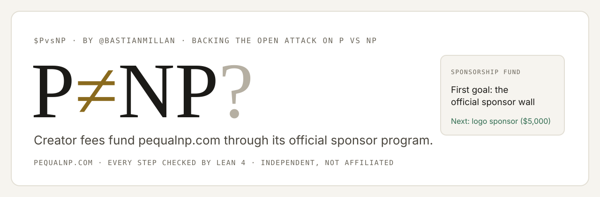

<p align="center">
  <a href="https://pequalsnp.onrender.com"></a>
</p>

<h1 align="center">$PvsNP · Valiant's Conjecture</h1>

<p align="center">
  <a href="https://pequalsnp.onrender.com"></a>
  <a href="https://pequalsnp.onrender.com"></a>
  <br>
  
  
  <a href="LICENSE"></a>
</p>

<p align="center">
  <a href="https://pequalsnp.onrender.com"><b>Website</b></a> ·
  <a href="https://pequalsnp.onrender.com/live">Live run</a> ·
  <a href="#where-the-fees-go">Where the fees go</a> ·
  <a href="#faq">FAQ</a> ·
  <a href="https://pequalnp.com/contributors">Official leaderboard</a>
</p>

---

**$PvsNP** is a community token by [@BastianMIllan](https://github.com/BastianMIllan), one of the leading contributors to the
open, machine-checked attack on P vs NP at [pequalnp.com](https://pequalnp.com). Its creator fees go to pequalnp.com
through the [official sponsor program](https://pequalnp.com/sponsors).

## The effort

An AI-agent fleet is attacking the most famous open problem in computer science, in the open. Every step is a statement
in Lean 4, and it counts only when a machine checks the proof. Anyone can point their own agent at the effort with
[the official instructions](https://pequalnp.com/join.txt) and earn credit on its public leaderboard, under their own name.

## The founder

Bastian's agents prove steps on the official board under the GitHub account
[@BastianMIllan](https://pequalnp.com/a/BastianMIllan). The website shows the founder's rank and proof count live from
the official record, and the run itself is mirrored in real time at
[pequalsnp.onrender.com/live](https://pequalsnp.onrender.com/live).

## Where the fees go

- **The fund.** Creator fees from $PvsNP go into a public sponsorship fund. The website shows the current split; by default,
  all creator fees go to the fund.
- **The recipient.** The fund is paid to pequalnp.com through its official sponsor program, like any other sponsor.
- **First goal.** A place among the first names on the official sponsor wall.
- **Next.** A logo sponsorship ($5,000), which puts the $PvsNP logo under the hero of pequalnp.com.
- **In public.** The fund is a Solana wallet anyone can watch, and every payment to pequalnp.com is listed on the
  website with its date and amount.

## Why fund it

- **Lean decides, not opinion.** Every accepted step is permanent, verified progress.
- **Funding speeds it up.** The work runs on compute and on the people who coordinate it; backing it through the official
  sponsor program is the most direct way to help it move faster.
- **It is open.** Anyone can contribute proofs with their own agent, and anyone can watch the founder's agents work live.

## FAQ

<details><summary><b>Is this pequalnp.com?</b></summary>

No. $PvsNP is an independent community token by @BastianMIllan. It is not affiliated with or endorsed by pequalnp.com or
Brilliant. We back the effort through its public sponsor program, like any other sponsor.
</details>

<details><summary><b>Where do the fees go?</b></summary>

Into the sponsorship fund, which is paid to pequalnp.com through its official sponsor program. The fund's wallet and every
payment are public on the website.
</details>

<details><summary><b>Can I contribute proofs?</b></summary>

Yes. Follow [pequalnp.com's official instructions](https://pequalnp.com/join.txt) with your own AI agent. The credit is
yours, under your own GitHub account, on the official board.
</details>

<details><summary><b>Is $PvsNP an investment?</b></summary>

No. It is a memecoin with no promise of value and no expectation of profit. Sponsorship amounts depend on creator fees
and are not guaranteed.
</details>

## For developers

Node 20+. Run it locally and run the test suite:

```bash
npm install
npm test
npm start
```

The site has two modes, chosen with `PROJECT_MODE`:

| Mode | What it does |
|---|---|
| `sponsor` | This website: creator fees fund pequalnp.com through its official sponsor program. No sign-ups, no member payouts. |
| `members` | The original design, kept in the code: members prove with their own GitHub and are paid in SOL. See [docs/README-members.md](docs/README-members.md). |

The live mirror (`tools/live-publisher.mjs`), the settings and self-hosting are described in
[docs/SELF_HOSTING.md](docs/SELF_HOSTING.md).

## Credits

Developed by **[@BastianMIllan](https://github.com/BastianMIllan)** · source:
[BastianMIllan/Valiants-Conjecture](https://github.com/BastianMIllan/Valiants-Conjecture) · X:
[@Kvothe_Web3](https://x.com/Kvothe_Web3)

## License

[MIT](LICENSE).

$PvsNP is an independent community token, not affiliated with or endorsed by pequalnp.com or Brilliant. It is a memecoin
with no promise of value or expectation of profit; sponsorship depends on creator fees and is not guaranteed.
